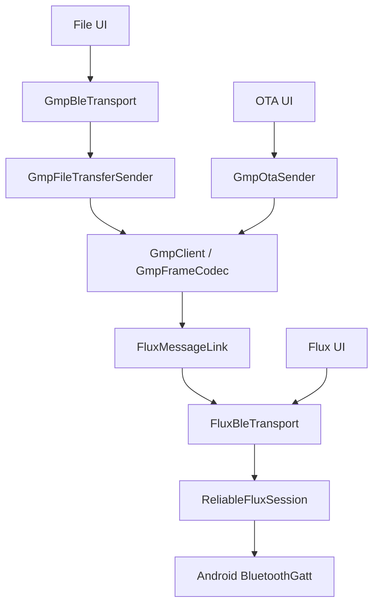

# Flux / GMP protocol layers

All three standalone apps use the same BLE and reliable Flux implementation:



`FluxBleTransport` owns scanning, GATT identity/lifetime, MTU, CCCD subscription,
and BLE writes. `FluxGattProfile` supplies service/RX/TX UUIDs; the GMP profiles
supply their own addresses. A connection becomes ready only after a successful
subscription. Each app instance owns its own transport and session.

`ReliableFluxSession` owns START/fragment creation, receive reassembly, windows,
SACK bitmap handling and retransmission. A successful `sendMessage` means all
fragments have been acknowledged by the peer. Messages submitted through the
shared transport are serialized; START and subsequent fragments use one writer.
Android may accept up to four outstanding writes. A busy return keeps the same
packet at the head and waits for a write callback or bounded backoff before
retrying. A congestion callback applies a 10–100 ms backoff; Flux SACK/timeout
retransmission recovers missing fragments without replaying an accepted START
blindly. Persistent congestion and other callback errors terminate the link.
Android callbacks release local capacity; they are never counted as peer ACKs.
Android does not expose the controller buffer/mbuf quota to applications, so
BUSY and congestion are used as backpressure signals. The four-write application
limit does not guarantee that Android accepts four concurrent operations.

`GmpClient` uses `FluxMessageLink`, shares `GmpFrameCodec` across OS, OTA and File
Transfer groups, and matches responses by operation, group, sequence and command.
Requests wait for both all Flux SACKs and the matching successful GMP response.
Incoming protocol frames use an event flow, independent of the UI message history.

`GmpFileTransferSender` owns META/DATA/FINAL/ABORT and file integrity. The reference
ESP receiver requires DATA block indices in order, so only one GMP DATA block is
outstanding. BLE writes and Flux fragments within that block still fill the
available window. This prevents a later completed block from reaching the receiver
before the expected block (`ESP_ERR_INVALID_SIZE`, detail `0x104`).

`GmpOtaSender` owns capability query, START, sequential DATA requests and FINISH.
FINISH retains image-size/SHA-256 validation and the device's apply/reboot flow.
The ViewModel only reads the selected file and exposes progress.

Transfer timing starts when BLE accepts the first DATA packet (or first raw Flux
packet). It spans every data segment and ends at the last corresponding ACK.
File META/hash calculation, OTA capability/START, and final verification/FINISH
are excluded. A successful transfer still requires the profile's final validation.

## Validation

```sh
./gradlew :app:testDebugUnitTest
```

Protocol tests cover ordered File blocks, a dropped Flux fragment during a full
file transfer, selective ACK progress, GMP response matching, link loss, OTA DATA
acknowledgements and timing boundaries. Physical Android/ESP BLE throughput,
reconnect behavior and OTA reboot still require device testing.
